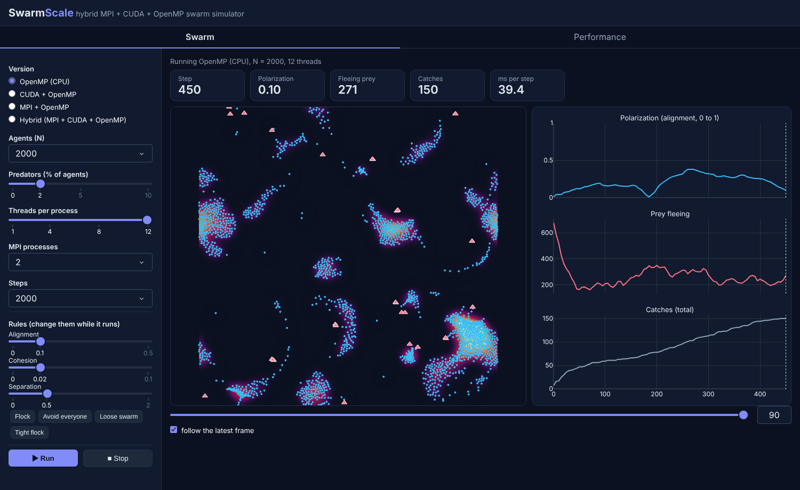
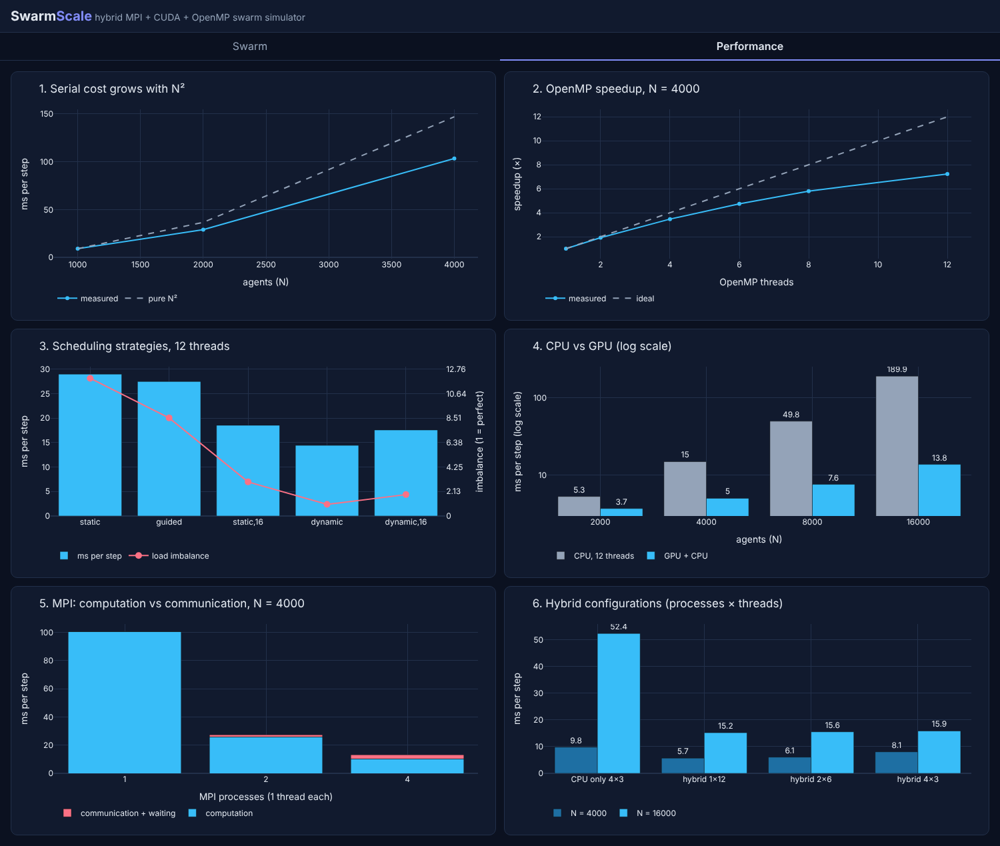

# SwarmScale

**A hybrid MPI + CUDA + OpenMP framework for large-scale agent-based swarm simulation.**




Thousands of agents (prey and predators) move in a 2D world. Prey flock using the Boids rules and flee from predators. Predators plan their hunts and prefer isolated prey (the "confusion effect"). Because every agent reacts to its neighbours, a direct simulation costs **O(N²)** per step. This project uses three parallel paradigms to bring that cost down and measures how much each one helps.

## How the work is split

| Layer | Paradigm | What it does |
|---|---|---|
| Across processes | **MPI** | The world is cut into vertical strips, one per rank. Agents that cross a border **migrate** (`MPI_Send`/`MPI_Recv`, even/odd ordering to avoid deadlock). Agents near a border are copied to the neighbour as read-only **ghosts**. Metrics and the density grid are combined with `MPI_Reduce` and `MPI_Bcast`. |
| On the GPU | **CUDA** | One thread per agent runs the O(N²) neighbour search (Boids sums, nearest threat, predator candidate lists). The density field uses `atomicAdd` for the deposit and two 1D convolution kernels (rows, then columns) for the Gaussian blur. |
| On CPU threads | **OpenMP** | Each agent's decision logic runs in a `parallel for` with `schedule(dynamic)`. The work is very uneven: predators run an expensive hunt-planning simulation. `reduction` combines the counters, and per-thread timing measures load imbalance. |

Each time step: ghost exchange → neighbour search (GPU) → density field → decisions (OpenMP) → captures → movement → migration → global metrics.

## Versions

| File | What it is |
|---|---|
| `swarm.c` | Serial / OpenMP version (1 thread = serial baseline) |
| `swarm_cuda.cu` | Neighbour search and density field on the GPU, decisions on the CPU |
| `swarm_mpi.c` | MPI domain decomposition (with OpenMP inside each rank) |
| `swarm_hybrid.cu` | Full hybrid: MPI strips, each rank using the GPU and OpenMP |

All versions produce identical results for the same configuration. For example, the hybrid with 2 ranks matches `swarm_mpi.c` with 2 ranks exactly, and every 1-process version matches `swarm.c`. That is how each parallel version was verified.

## Results

Measured on a laptop with an Intel Core 5 210H (4 performance + 4 efficiency cores, 12 threads) and an NVIDIA RTX 4050 Laptop GPU, 100 steps per run, median of 3 runs. The full data is in [`results/bench.csv`](results/bench.csv).



**OpenMP, N = 4000:** 7.2× speedup on 12 threads. `dynamic` scheduling is **2× faster** than `static`: under `static`, thread 0 gets all the predators and does about 12× the average work (load imbalance 11.96 vs 1.01).

| Schedule (12 threads) | static | guided | static,16 | dynamic,16 | dynamic |
|---|---|---|---|---|---|
| ms per step | 29.0 | 27.5 | 18.5 | 17.6 | **14.4** |

**CPU (12 threads) vs GPU:** the GPU's advantage grows with N.

| Agents | 2000 | 4000 | 8000 | 16000 |
|---|---|---|---|---|
| CPU, ms per step | 5.3 | 15.0 | 49.8 | 189.9 |
| GPU + CPU, ms per step | 3.7 | 5.0 | 7.6 | **13.8** |
| Speedup | 1.4× | 3.0× | 6.5× | **13.8×** |

**MPI, N = 4000, 1 thread per rank:** 100.6 → 27.3 → 13.1 ms per step for 1, 2 and 4 ranks (3.7× and 7.7×). The speedup is **superlinear** because each rank only compares its own agents and ghosts, so pairs too far apart to interact are never checked. Communication grows from 0% to 22% of the time.

**Hybrid, N = 16000:** 15.2 ms per step against 52.4 ms for the best CPU-only MPI + OpenMP configuration (3.4×). On a single machine with one shared GPU, the extra MPI ranks add communication without adding hardware, so plain GPU + OpenMP is slightly faster (13.8 ms). The hybrid design pays off on clusters where each rank has its own CPU and GPU.

**Overall, N = 4000:** serial 103.4 ms per step → GPU + OpenMP 5.0 ms per step, **20.6× faster**.

## Requirements

Linux or WSL2 with `gcc`, OpenMPI (`mpicc`, `mpirun`), the CUDA Toolkit (`nvcc`) and Python 3.

```bash
sudo apt install build-essential openmpi-bin libopenmpi-dev python3-venv
python3 -m venv .venv
.venv/bin/pip install -r requirements.txt
```

## Build and run

```bash
# OpenMP / serial
gcc -O2 -fopenmp swarm.c -o swarm -lm
OMP_NUM_THREADS=12 OMP_SCHEDULE=dynamic ./swarm

# CUDA
nvcc -O2 --fmad=false -arch=sm_89 -Xcompiler -fopenmp swarm_cuda.cu -o swarm_cuda -lgomp
./swarm_cuda

# MPI (even number of processes; strips must be at least 30 units wide)
mpicc -O2 -fopenmp swarm_mpi.c -o swarm_mpi -lm
OMP_NUM_THREADS=3 mpirun -np 4 ./swarm_mpi

# Hybrid
nvcc -O2 --fmad=false -arch=sm_89 -ccbin mpicxx -Xcompiler -fopenmp swarm_hybrid.cu -o swarm_hybrid -lgomp
OMP_NUM_THREADS=6 mpirun -np 2 ./swarm_hybrid
```

Compile-time options: `-DN=4000` (agents), `-DSTEPS=500`, `-DSAVE_EVERY=0` (no output files), `-DPRED_PCT=5` (predator percentage).

`--fmad=false` makes the GPU round exactly like the CPU, so GPU results match the CPU versions bit for bit. `-arch=sm_89` targets the RTX 40 series; change it for other GPUs.

## Dashboard

```bash
.venv/bin/python dashboard.py      # then open http://localhost:8050
```

- **Swarm tab:** pick a version, agent count, predator percentage and thread/process counts, then press Run. The dashboard compiles and runs the real C/CUDA/MPI program and shows the swarm live with its density field and metrics. The rule sliders (alignment, cohesion, separation) change the simulation **while it runs**, through `controls.txt`.
- **Performance tab:** charts from `results/bench.csv`.

## Benchmarks and animation

```bash
python3 bench.py           # all experiments, 3 repeats each -> results/bench.csv
python3 bench.py --quick   # 1 repeat, for a fast check
./swarm && .venv/bin/python animate.py   # renders swarm.gif from frames.csv + density.csv
```

